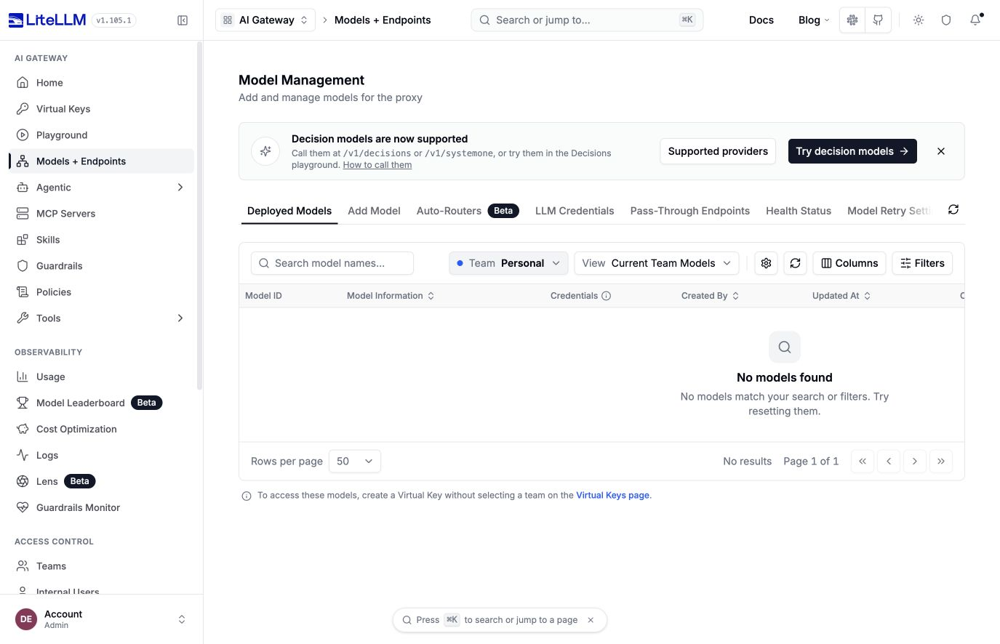

# Prefixed component UI browser proof

Before source is 30ada9d26a151e85a3ea674c2d769efa9dadb90a. After source is c718c28d96a27a9612dbd1e601535746ee2b58a2

The same URL is http://localhost:43040/services/llm/ui/models-and-endpoints/. Both captures use the same disposable PostgreSQL database with no models or providers. The backend uses real LiteLLM services and authentication, without API mocks or inference calls

The before export comes from a native AMD64 build of the source UI Dockerfile. The after export was compiled on native macOS with Node 24 and the source lockfile. Both exports run in native ARM64 nginx 1.31.5 containers using the source nginx configuration and entrypoints unchanged. The after runtime includes the source prefix preparation script

A local reverse proxy exposes UI and management requests only beneath /services/llm. SERVER_ROOT_PATH is /services/llm. The same backend and database remain in place when swapping UI containers

## Before

1. Open http://localhost:43040/services/llm/ui/models-and-endpoints/
2. Observe nginx HTTP 404 before the UI can render

## After

1. Open http://localhost:43040/services/llm/ui/models-and-endpoints/
2. Sign in using the disposable local administrator account
3. Observe Model Management, Admin role and No models found
4. Refresh the page and follow sidebar links under /services/llm/ui/

This verifies the componentized UI prefix and local password login. Google SSO was separately confirmed against the v1.105.1 deployment, rather than this disposable environment
